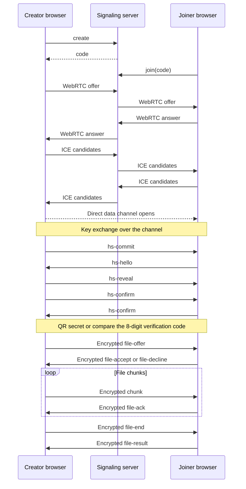
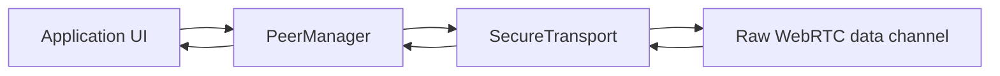

# QuickDrop

QuickDrop is a browser app for transferring files directly between two devices.

**Live site:** [quickdrop-web-ypyd.onrender.com](https://quickdrop-web-ypyd.onrender.com)<br />
The free host sleeps when idle; the first pairing can take up to a minute.

## Demo


### Screenshots


<!-- The owner will add these image files. -->

## Features

- Direct browser-to-browser file and text transfer over a WebRTC data channel.
- End-to-end message encryption with AES-256-GCM.
- Pairing through a QR link or short code.
- Verification digits for code-based pairing.
- Large files streamed in chunks with backpressure and acknowledgements.
- SHA-256 file integrity checking.
- Receiver accept/decline prompts, transfer progress, and cancellation.
- No accounts; file contents are not stored on a server.

## How it works

### Pairing and transfer



The `file-accept` and related control-message names are defined in
[`apps/web/src/lib/protocol.ts`](apps/web/src/lib/protocol.ts). The handshake
message names are defined in
[`apps/web/src/lib/secureChannel.ts`](apps/web/src/lib/secureChannel.ts).

### Message path



`SecureTransport` carries out the handshake, encrypts outgoing application messages,
and decrypts incoming messages before delivering them to the application.

## Security

Each session uses ephemeral P-256 ECDH and HKDF-SHA-256, with the key derivation
bound to the WebRTC DTLS fingerprints. Application messages are protected with
AES-256-GCM. QR pairing uses a random secret in the URL fragment; code pairing
requires users to compare the 8-digit verification code before sending. The signaling
server relays connection setup and holds short-lived session data, but does not
receive file contents; see the [security and threat model](docs/SECURITY.md).

## Tech stack

Versions and ranges below are from the workspace package manifests.

| Technology      |                       Version or source | Use                              |
| --------------- | --------------------------------------: | -------------------------------- |
| React           |                               `^18.3.0` | Web interface                    |
| Vite            |                                `^5.4.0` | Web development and build        |
| TypeScript      |                                `^5.5.0` | Application and server language  |
| Vitest          |                                `^2.0.0` | Automated tests                  |
| Node.js         | `>=20.0.0` (Render Blueprint sets `22`) | Signaling server runtime         |
| `ws`            |                               `^8.18.0` | Signaling WebSocket server       |
| Zod             |                               `^3.23.0` | Message validation               |
| `@noble/hashes` |                                 `1.4.0` | SHA-256 file integrity hashing   |
| `qrcode`        |                                 `1.5.4` | QR generation                    |
| Web Crypto API  |                             Browser API | Key exchange and encryption      |
| WebRTC          |                             Browser API | Peer connection and data channel |
| pnpm            |                               `>=9.0.0` | Workspace package manager        |

The repository uses pnpm workspaces.

## Repository layout

```text
apps/
  web/            React and Vite browser app
  signaling/      Node.js WebSocket signaling server
packages/
  protocol/       Shared signaling protocol package
docs/
  SECURITY.md     Security and threat model
  images/         Demo and screenshot assets
render.yaml       Render Blueprint
```

## Run locally

Prerequisites: Windows 11, Node.js 22, and pnpm enabled through Corepack. From the
repository root, in PowerShell:

```powershell
corepack enable
pnpm install
```

If pnpm asks you to approve dependency build scripts, run:

```powershell
pnpm approve-builds
```

Then run these commands in separate terminals:

```powershell
pnpm dev:signaling
```

```powershell
pnpm dev:web
```

Open the web app at [http://localhost:5173](http://localhost:5173). The local web
app uses `ws://localhost:3001` for signaling by default.

## Tests and quality

Run from the repository root:

```powershell
pnpm typecheck
pnpm lint
pnpm test
```

These commands invoke the corresponding scripts in the root `package.json`.

## Deployment

The repository's [`render.yaml`](render.yaml) defines a Render Blueprint with a
Node.js signaling service and a static site for the web app. The Blueprint builds
the shared protocol package before the app that uses it, and publishes the web
build from `apps/web/dist`.

Configure the deployment settings:

- `ALLOWED_ORIGINS`: on the signaling service, set the exact HTTPS origin of the
  deployed web app.
- `VITE_SIGNALING_URL`: on the static site, set the signaling WebSocket URL using
  `wss://`. This is a build-time web app setting.

The Blueprint currently contains Render hostnames for these services; update them
if the service URLs differ in your Render account.

## Limitations

- The free host sleeps when idle, so the first pairing can take up to a minute.
- On browsers without the File System Access API, the receiver holds the file in
  memory; the code limits this path to 2 GiB.
- Direct WebRTC connections can fail on some restrictive networks because there is
  no TURN relay yet.
- QuickDrop does not scan file contents.

## Roadmap

- TURN fallback.
- PWA install support.
- Dark mode.
- Multi-file queue.
- Resume interrupted transfers.
- Content Security Policy (CSP).

## License

MIT. See [LICENSE](LICENSE).

## Built with AI assistance

Designed and reviewed by the owner; code was written with AI coding agents, with
tests. See [docs/SECURITY.md](docs/SECURITY.md) for the threat model.
